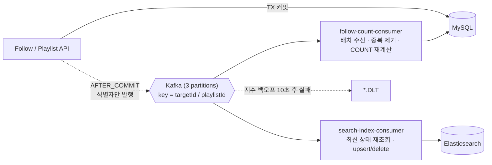
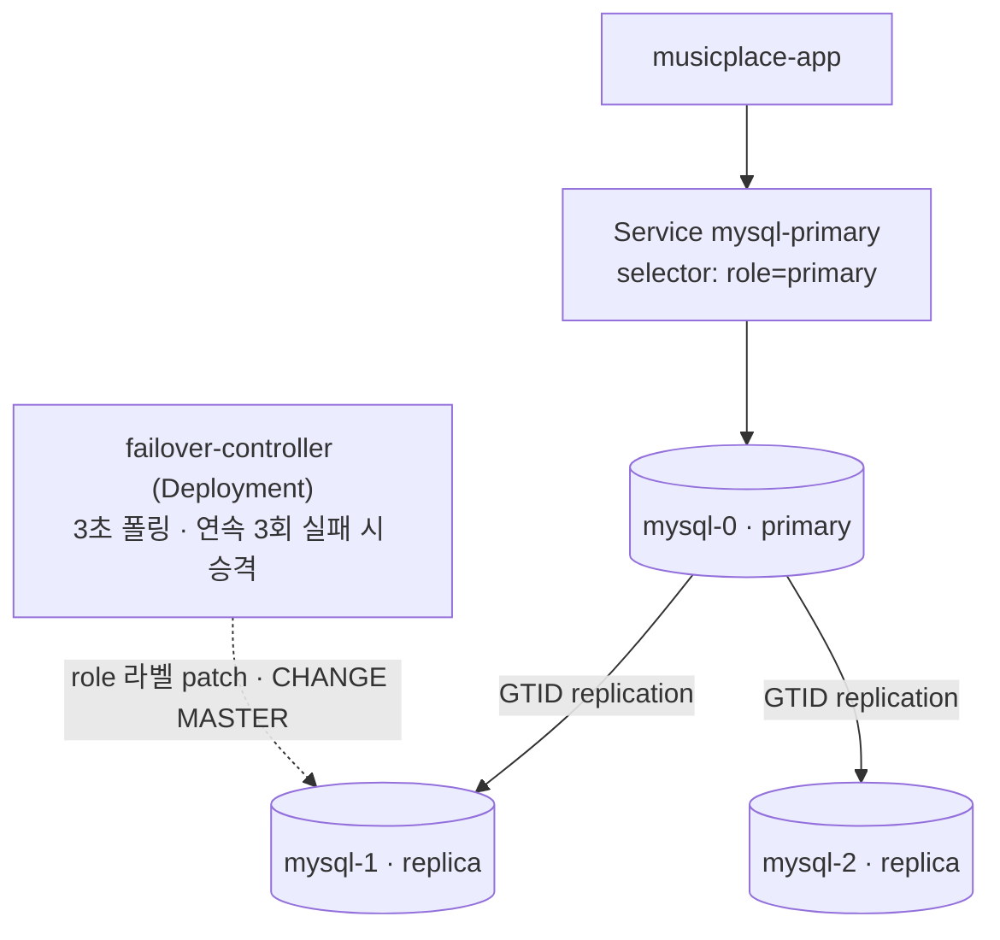
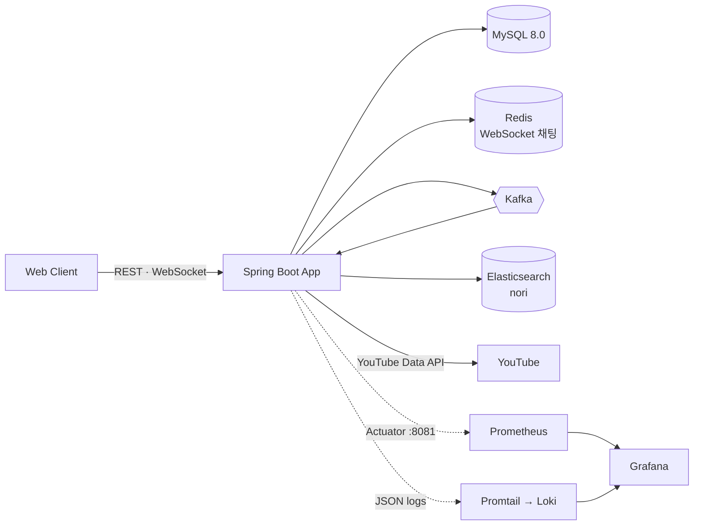

# 🎵 Music Place — Backend

플레이리스트 공유 · 실시간 스트리밍 · 채팅(WebSocket) 서비스의 백엔드입니다.
캡스톤 프로젝트(2인)로 만든 서비스를 이후 **단독으로 "측정 → 병목 분석 → 개선 → 재측정"** 하며 확장했고, 각 결정의 근거와 실험 결과를 이 저장소에 남겼습니다.

| 구분 | 내용 |
| --- | --- |
| 서비스 | 플레이리스트 공유·스트리밍·채팅, 학과 구성원 20명 대상 운영 |
| 기간 | 개발 2024.03 ~ 2024.11 (2인) · 성능 개선·확장 2025.11 ~ 2026.09 (단독) |
| 스택 | Java 21 · Spring Boot 3.2.4 · JPA · MySQL 8.0 · Redis · Kafka · Elasticsearch(nori) · WebSocket |
| 운영·검증 | Docker Compose · Kubernetes(minikube) · LitmusChaos · k6 · Prometheus / Grafana / Loki / Alertmanager · GitHub Actions |

---

## 한눈에 보기

| 주제 | 문제 | 접근 | 결과 |
| --- | --- | --- | --- |
| [조회 성능](#1-조회-성능-개선) | 플레이리스트 조회 응답 지연 | JPA 연관관계 → FK 기반 구조 재설계 + 복합 인덱스 | 평균·P95 응답시간 **약 46~47% 단축** (k6 + Prometheus/Grafana) |
| [Follow 동시성](#2-follow-동시성--트랜잭션-실험) | check-then-act 구조의 중복 팔로우 / 카운트 정합성 | 재현 → 수정 → 격리 수준 비교 → 락 3종 비교 | 3방식 모두 정합성 확인, **고경합에서 낙관적 락이 비관적 락보다 2배 이상 느림** (p95 2,430ms vs 790ms) |
| [Kafka 비동기 집계](#3-kafka로-follower_count-비동기-집계) | 팔로우 버스트 시 같은 row 갱신 경합 | 관계 저장은 동기, 카운트 재계산만 Kafka로 분리 | 30 VU × 3분 혼합 시나리오 **5xx 0건**, consumer lag 0, API 값 = `COUNT(*)` 값 |
| [Elasticsearch 검색](#4-elasticsearch-검색--색인-파이프라인) | MySQL FULLTEXT(ngram)의 한국어·오타 한계 | nori + fuzziness, MySQL → Kafka → ES 색인 | 무관 키워드 오매칭 **5건 → 0건**, 곡 정보 조인 검색 노이즈 **7건 → 의도한 1건** |
| [MySQL HA / 카오스](#5-mysql-ha--chaos-experiment) | 단일 MySQL Pod = 장애 시 서비스 중단 | Primary-Replica(GTID) + 자체 failover 컨트롤러, LitmusChaos로 검증 | primary 삭제 시 수동 개입 없이 **약 10초 내 승격·재합류** (오탐 방지 설계 포함) |

---

## 1. 조회 성능 개선

- **진단**: k6 부하 테스트와 Prometheus/Grafana(JVM · HikariCP · 응답시간 P50~P95 · 오류율 패널)로 병목 구간을 먼저 특정했습니다.
- **개선**: JPA 연관관계 매핑을 외래키 기반 구조로 재설계하고, 조회 패턴에 맞춰 복합 인덱스를 설계했습니다.
- **결과**: 평균·P95 응답시간 **약 46~47% 개선**.

JPA는 SQL을 대체하는 도구가 아니라 편의 계층이라는 관점으로, 쿼리와 인덱스 수준에서 원인을 확인하는 방식을 택했습니다.

## 2. Follow 동시성 · 트랜잭션 실험

"동시성 문제는 재현할 수 있어야 고쳤다고 말할 수 있다"는 기준으로 3단계로 진행했습니다.

**A. check-then-act 경쟁 상태**
- `existsBy… → save` 구조에서 동시 요청 시 유니크 제약 위반이 처리되지 않은 500으로 이어짐을 확인.
- 30 VU 동시 팔로우 재현 테스트(`load-test/scenarios/follow-experiment/follow-race-test.js`)를 작성하던 중, 동시성과 무관하게 **엔티티에 없는 `NOT NULL` 컬럼 때문에 모든 INSERT가 실패하는 스키마 불일치**를 먼저 발견해 바로잡았습니다.
- 수정 후 결과: 성공 1건 · 중복 응답(409, `FOLLOW_ALREADY_EXISTS`) 29건 · **미처리 500 0건**. 최종 방어선은 DB 유니크 제약 `(member_id, target_id)`이고, 위반은 409로 변환합니다.

**B. 격리 수준 비교** (`FollowIsolationExperimentTest`)
- 실제 MySQL에 붙여 `CountDownLatch`로 리더/라이터 스레드를 동기화.
- REPEATABLE READ: 같은 트랜잭션의 두 번째 읽기가 첫 번째와 동일 / READ COMMITTED: 그 사이 커밋된 변경(+1)을 반영.

**C. `follower_count` 캐시 컬럼 + 동시성 제어 3방식 비교** (30 VU, k6)

| 방식 | avg | p95 | max | 최종 followerCount |
| --- | --- | --- | --- | --- |
| 비관적 락 (`SELECT … FOR UPDATE`) | 599ms | 790ms | 811ms | 30 ✅ |
| 낙관적 락 (`@Version` + 재시도) | 1,368ms | 2,430ms | 2,601ms | 30 ✅ |
| Unique 제약 + 배치 재계산 | **115ms** | **148ms** | 157ms | 30 ✅ |

- "낙관적 락은 충돌이 적을 때 유리하다"는 통념의 **반대 사례**입니다. 같은 row에 30개 요청이 몰리면 재시도마다 트랜잭션 재실행 + 백오프 대기가 쌓여 p95/max가 평균보다 크게 벌어집니다.
- 처음 설정(재시도 5회, 고정 백오프)에서는 한 스레드가 재시도를 소진해 `ObjectOptimisticLockingFailureException`으로 **테스트가 실패**했고, 재시도 30회 + 지수 백오프 + 지터로 조정해 통과시켰습니다.
- 재시도 루프에서 같은 클래스의 `@Transactional` 메서드를 `this.`로 호출하면 프록시를 거치지 않아 트랜잭션이 무시되는 **self-invocation 문제**도 겪었고, 트랜잭션 로직을 별도 빈(`FollowCountTransactionalOps`)으로 분리해 해결했습니다.
- **선택**: 락 없이 정합성을 지키는 "Unique 제약 + 재계산" 방식 → 다음 단계(Kafka)로 이어짐.

## 3. Kafka로 `follower_count` 비동기 집계

**왜 Kafka인가** — 기술을 위한 기술 도입을 피하려고 범위를 두 곳(Follow, 검색 색인)으로 제한했습니다. 2번에서 검증한 "배치 재계산이 가장 빠르다"는 결과 위에, 파티션 키로 순서를 보장하고 replay가 가능한 점을 근거로 선택했습니다.



**설계 결정**
- 팔로우 관계 저장(insert/delete)은 **동기 유지**(정합성), `follower_count` 갱신만 비동기.
- 이벤트에 `+1/-1` delta를 싣지 않고 **`targetId`만** 전달 → 컨슈머가 `COUNT`로 재계산하므로 **자연 멱등**. 중복 처리·재시도·replay가 안전하고, 같은 배치 안의 동일 `targetId`는 한 번만 계산.
- `@TransactionalEventListener(AFTER_COMMIT)`으로 커밋된 변경만 발행.
- 컨슈머: 배치 리스너 + `MANUAL_IMMEDIATE` ack, `ExponentialBackOff(1s, ×2, 최대 10s)` 후 DLT 전송. DLT 적재 건수는 Micrometer 카운터(`follow_count_events_dlt_total`)로 노출.

**검증** (k6, 팔로우/언팔로우 혼합 30 VU × 3분 — `load-test/scenarios/kafka-test/`)
- checks 100%(2,269/2,269) · 5xx 0건 · P95 대부분 50ms 이하 · HikariCP active connection 최대 1
- consumer lag 0 · `GET /follow/otherCount/{id}` 응답(9) = `SELECT COUNT(*)` 결과(9)

## 4. Elasticsearch 검색 + 색인 파이프라인

- **요구사항**: 유튜브 수준의 검색 — 한국어 형태소 매칭, 오타 허용, relevance 정렬. 먼저 MySQL만으로 구현하고(FULLTEXT ngram) 그 결과를 기준선으로 ES와 비교했습니다.
- **쿼리**: `multi_match` (`title^3`, `comment^2`, `searchText^1`) + `fuzziness: AUTO`, 정렬은 relevance / 최신순. 분석기는 `nori_tokenizer` + `nori_part_of_speech` ([`elasticsearch/init/create-playlist-index.sh`](elasticsearch/init/create-playlist-index.sh)).
- **색인 동기화**: Follow에서 검증한 Kafka 패턴을 그대로 재사용 — `AFTER_COMMIT` 발행 → **식별자만 전달** → 컨슈머가 MySQL에서 **최신 상태를 다시 읽어** upsert → 실패는 DLT. 삭제되었거나 비공개로 전환된 재생목록은 인덱스에서 제거합니다. 기존 데이터는 백필 서비스(`PlaylistSearchBackfillService`)로 색인.
- **결과** (MySQL FULLTEXT ngram 대비)
  - 오타 허용: 정확 키워드 9.47 > 오타 키워드 8.82 — 오타도 매칭되되 정확 일치가 더 높게 랭킹
  - 무관 키워드 검색 오매칭 5건 → 0건
  - 곡 정보 조인 검색 노이즈 7건 → 의도한 1건

## 5. MySQL HA + Chaos Experiment

LitmusChaos로 DB 장애를 주입하다가 "Pod를 지우면 서비스가 멈춘다"는 문제를 확인했고, **Primary-Replica + 자체 failover 컨트롤러**로 해결했습니다. (로컬/학습 환경 · minikube)



- **구성**: StatefulSet 3 Pod(`server-id` = 100 + ordinal), initContainer에서 `mysqldump`로 replica 초기 복제, `MASTER_AUTO_POSITION=1`(GTID).
- **컨트롤러** ([`k8s/mysql/failover/`](k8s/mysql/failover)): Kubernetes API(REST)로 `role` 라벨을 조회·patch → primary 연속 3회 ping 실패 시 replica 중 하나를 승격하고 나머지를 새 primary로 재설정, `role` 라벨이 둘 이상이면 split-brain guard가 강등, 라벨 없는 Pod는 replica로 재합류.
- **카오스 시나리오**: [`k8s/chaos/experiments/`](k8s/chaos/experiments) — `pod-delete`(앱 `/actuator/health` HTTP probe 포함), 커넥션 풀 고갈.

**감지 속도 vs 오탐 — 실험으로 확인한 트레이드오프**

| 방식 | primary 삭제 후 복구 | 비고 |
| --- | --- | --- |
| k8s 기본 재생성 (baseline) | 약 14초 | Pod가 `1/1 Running`이 될 때까지 |
| 컨트롤러 v1 (ping 1회 실패 즉시 승격) | 약 2초 | **k6 부하 중 정상 primary를 장애로 오판**(timeout 2초) → 불필요한 재승격 발생 |
| 컨트롤러 v2 (연속 3회 실패 + timeout 5초) | 약 10초 (감지 약 9초 + 승격·재구성 약 1초) | 오탐 제거 |

- 단순히 가장 빠른 수치를 택하지 않고, **오탐 가능성을 실측으로 확인한 뒤 감지 시간을 늘리는 쪽**을 선택했습니다.
- k6 8분 평균 DB 의존 오류율은 baseline 0.25% / v2 0.07% / v2 재실험 0.22%로, 장애 구간(10~14초)이 8분 평균에 희석되어 **방식 간 차이로 해석하지 않았습니다.** 장애 구간 단독 지표는 Prometheus scrape 간격(10s)과 장애 지속 시간이 비슷해 해상도가 부족했습니다.

**겪은 문제와 해결**

| 증상 | 원인 | 해결 |
| --- | --- | --- |
| initContainer 스크립트 실패 | `mysql:8.0` 이미지에 `hostname` 명령 없음 | Downward API(`POD_NAME`)로 Pod 이름 주입 |
| replica 최초 초기화 실패 | `read_only`/`super_read_only`가 root 비밀번호 설정까지 차단 | 최초 실행에만 CLI 플래그로 해제 |
| 새 PVC인데 옛 데이터가 남음 | minikube provisioner가 삭제된 PV를 `Released`로 방치 | PVC 삭제 후 잔여 PV 확인·수동 삭제 |
| primary Pod 삭제 시 승격이 안 됨 | Pod 삭제로 `role=primary` 라벨도 함께 사라졌고, 컨트롤러는 "라벨 없음"을 경고만 함 | `need_failover` 플래그로 "라벨 없음"과 "ping 실패"를 모두 승격 트리거로 처리 |
| 컨트롤러가 primary를 못 찾음 | k8s API 응답이 pretty-print JSON이라 공백 없는 grep 패턴 불일치 | 정규식에 공백 허용 |
| 앱 `CrashLoopBackOff` | 헤드리스 Service가 replica로도 라우팅 → DDL이 `super_read_only`에 막힘 | 앱 DB URL을 `role=primary` selector Service로 변경 |
| 카오스 실험의 DB 요청 오류율 100% | k8s DB에 테스트 계정 시딩 누락 | 시딩 후 재실행, 장애 구간만 좁혀서 분석 |

## 6. Kafka 연동 중 겪은 문제 (실제 로그 기반)

| 증상 | 원인 | 해결 |
| --- | --- | --- |
| API는 200인데 `follower_count`가 갱신 안 됨 | `application.yml`의 serializer 설정이 런타임에 적용되지 않아 `AFTER_COMMIT` 시점에 직렬화 예외 → **이미 커밋된 뒤라 조용히 묻힘** | `KafkaProducerConfig`에서 `JsonSerializer`를 코드로 고정, 발행 실패는 반드시 로그로 남김 |
| 발행된 이벤트가 전량 DLT로 이동 | 컨슈머가 프로듀서의 `__TypeId__` 헤더 기반 타입을 신뢰하지 못해 역직렬화 거부 | 헤더 타입 추론을 끄고(`setUseTypeHeaders(false)`) 고정 타입으로 역직렬화 |
| 부팅 시 예외 `must be configured with property setters, or via configuration properties; not both` | 코드의 `addTrustedPackages()`와 YAML 설정을 동시에 사용 | YAML 쪽 제거, 코드로 일원화 (`application-loadtest.yml`에도 동일 반영) |
| consumer lag 메트릭이 Grafana에 안 보임 | 커스텀 `ConsumerFactory`를 정의하면 Boot의 Micrometer 자동 계측이 물러남 | `MicrometerConsumerListener`를 직접 등록 |

공통 교훈: **"설정 파일 값이 실제 런타임에 반영됐는지"는 로그와 메트릭으로 직접 확인**해야 한다.

## 7. 관측성 · 부하 테스트 환경

- **메트릭**: Actuator(관리 포트 8081 분리) → Prometheus → Grafana. 대시보드는 코드로 프로비저닝([`monitoring/grafana/`](monitoring/grafana)) — JVM · HikariCP · 응답시간(P50~P95) · 오류율 등.
- **로그**: JSON 로그 → Promtail → Loki, 요청 ID·사용자 ID를 MDC로 주입. **알림**: Alertmanager.
- **부하 테스트**: k6 시나리오 — warm-up → load → stress, Follow 경쟁 상태/전략 비교, Kafka 혼합, 카오스 실험 ([`load-test/scenarios/`](load-test/scenarios)).
- **테스트 코드**: JUnit5 + H2 슬라이스/Mockito 단위 테스트(user · playlist · comment · music), Follow 실험 테스트는 실제 MySQL 사용. 테스트 작성 중 `JwtAuthenticationFilter`가 인증 객체를 `SecurityContext`에 설정하지 않는 결함을 발견해 수정했습니다.

---

## 시스템 구성



## 기술 스택

- **Backend** — Java 21, Spring Boot 3.2.4, Spring Data JPA, Spring Security(JWT), WebSocket, Spring for Apache Kafka, Spring Data Elasticsearch
- **Data** — MySQL 8.0(Primary-Replica), Redis 7, Elasticsearch(nori), Kafka 3.7(KRaft)
- **Infra / Observability** — Docker Compose, Kubernetes(minikube), LitmusChaos, Prometheus, Grafana, Loki, Promtail, Alertmanager, k6
- **CI/CD** — GitHub Actions → Docker Hub → GCP Compute Engine

## 디렉터리 구조

```text
src/main/java/org/musicplace
├─ playList/   재생목록 · 댓글 · 곡 · 검색(search/) · 색인 이벤트(kafka/)
├─ follow/     팔로우 · follower_count 이벤트(kafka/) · 동시성 실험 코드(*Experiment*)
├─ user/       회원 · 인증
├─ chat/       WebSocket 채팅
├─ Youtube/    YouTube Data API 연동
└─ global/     security · kafka 설정 · logging · exception
src/test/            단위·슬라이스 테스트 + Follow 격리 수준/락 실험 테스트
load-test/scenarios/ k6 시나리오 (stress-test · follow-experiment · kafka-test · chaos-experiment)
monitoring/          grafana · loki · promtail · alertmanager 설정
k8s/                 app · mysql(statefulset · failover) · redis · chaos(LitmusChaos) · k6-job
elasticsearch/init/  인덱스 생성 스크립트
docker-compose.yml        배포용 (GitHub Actions)
docker-compose-test.yml   부하 테스트 · 모니터링 · Kafka · ES 전체 스택
```

## 실행 방법

```bash
# 1) .env 작성
#    DOCKER_MYSQL_PASSWORD, DOCKER_MYSQL_DATABASE, DOCKER_MYSQL_CHARSET, DOCKER_MYSQL_COLLATION,
#    DOCKER_REDIS_PASSWORD, DOCKER_TZ, JWT_SECRET, JWT_ACCESS_TIME, YOUTUBE_API_KEY

# 2) 전체 스택 실행 (앱 + MySQL + Redis + Kafka + ES + 모니터링)
docker compose -f docker-compose-test.yml up -d --build

# 3) Elasticsearch 인덱스 생성 (최초 1회)
./elasticsearch/init/create-playlist-index.sh

# 4) 부하 테스트 (k6) — 사전 시딩된 테스트 계정(testuser1~10) 필요
docker compose -f docker-compose-test.yml --profile test run --rm k6 run /scripts/scenarios/stress-test/02-load-test.js
```

| 서비스 | 주소 |
| --- | --- |
| Grafana | http://localhost:3000 |
| Prometheus | http://localhost:9090 |
| Kafka UI | http://localhost:8090 |
| Elasticsearch | http://localhost:9200 |

## 한계와 개선 여지

- **Outbox 미적용**: `AFTER_COMMIT` 이후 발행이라 브로커 장애 시 이벤트가 유실될 수 있습니다(로그로만 추적). `follower_count`는 재계산 방식이라 다음 이벤트에서 보정되지만, 전체 재계산 쿼리(`recalculateAllFollowerCounts`)를 주기 실행하는 배치는 없습니다.
- **단일 노드 · 복제 계수 1**: 로컬 학습 환경이라 Kafka 브로커와 Elasticsearch는 단일 노드입니다.
- **failover 컨트롤러**: 승격 후보를 `gtid_executed` 문자열 길이로 비교하는 단순 휴리스틱이고, 컨트롤러 자체가 단일 Pod(replicas 1)이며 fencing은 라벨 기반 guard까지만 구현되어 있습니다. 운영 환경이라면 Orchestrator·Operator 같은 검증된 도구를 먼저 검토해야 하는 영역입니다.
- **CI**: 배포 워크플로가 `-x test`로 빌드하므로 테스트가 CI에서 실행되지 않습니다.
- **실험 코드**: Follow 실험용 컨트롤러·서비스(`*Experiment*`)가 `src/main`에 함께 있어, 별도 프로파일이나 모듈로 분리하는 것이 깔끔합니다.
